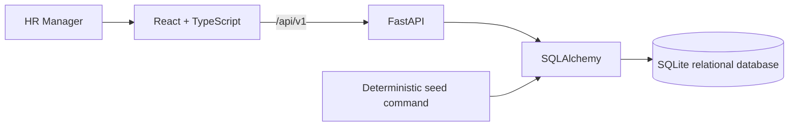

# Architecture and Trade-offs

## Request flow

The browser owns view state, query filters, pagination, and form interaction. FastAPI owns validation, filtering, persistence, and compensation analytics. SQLAlchemy models the employee table and keeps database access behind the API. Vite proxies API traffic in development so the UI uses a same-origin `/api` path.

## Data decisions

- One employee row contains the current salary, ISO-style currency code, status, and effective date. Employee ID and email have unique database constraints.
- Salary is a fixed-precision decimal. Input validation rejects zero/negative values, malformed currency codes, invalid statuses, and malformed employee IDs/emails.
- Compensation updates use a database transaction; unique identity conflicts return `409`, missing employees return `404`, and invalid input returns `422`.
- Directory endpoints cap page size at 100 and use indexed identity and common filter columns. Stable secondary ordering makes paging deterministic.
- The seed generator uses a fixed random seed, unique IDs/emails, and fictional names/salaries across eight countries and eight currencies. It refuses to add records to a non-empty database.

## Analytics correctness

Every salary aggregate, average, median, and top-earner ranking is scoped to a currency. Country and team summaries carry the currency alongside each group. The UI makes the selected currency visible and does not sum or rank values across currencies.

For this 10,000-record assessment dataset, analytics loads the filtered population to compute exact medians and top-five rankings. This keeps the initial implementation clear and the result deterministic. For materially larger datasets, move median/ranking work into database-specific window/percentile queries, verify query plans, and consider precomputed aggregates. SQLite is a single-node demo choice, not a high-availability deployment target.

## Deliberate trade-offs

- SQLite avoids infrastructure setup and provides relational constraints. `DATABASE_URL` allows another SQLAlchemy driver, but production migration to PostgreSQL would need a driver, schema migrations, backups, and deployment configuration.
- The UI uses small local components and CSS rather than a heavy component framework; Lucide supplies consistent icons. This keeps the assessment build lean.
- Search is substring-based over employee ID, first/last name, and email. A production-scale global directory would use database-native full-text search and query-plan verification.
- Salary edits replace the current amount and effective date; there is no full compensation history, approval chain, or audit ledger.
- Seeded records are synthetic and do not model country-specific payroll, tax, equity, bonus, or legal policy.

## Before real organizational use

Require authenticated SSO and role-based authorization, immutable audit/history, encryption and secrets management, data-retention policies, validated ISO 4217/country policy, backups, monitoring, error reporting, and security/privacy review. None of those controls are implied by this local prototype.